# ansible-infra

用 Ansible 管理同一批 Ubuntu 机器上的三件事：GPU 运行环境、Kubernetes 集群、磁盘操作说明。控制节点读 `inventory/inventory.ini`，再执行对应 playbook。磁盘部分不是 playbook，是手工步骤。

使用流程：





## 目录

| 路径 | 作用 |
|---|---|
| `inventory/inventory.ini` | 主机、分组、连接方式。含口令，不要外传。模板是 `inventory.ini.example` |
| `gpuenv/` | NVIDIA 驱动、CUDA、OFED、NCCL、NVSHMEM 等。安装、检测、卸载各一个 playbook |
| `kubernetes/` | kubeadm 集群、CNI、NFS、Harbor、Prometheus |
| `disk-manager/disk-lvm.md` | NVMe / LVM 手工步骤，不由 Ansible 执行 |
| `install_ansible.sh` | 控制节点安装 Ansible |

细节在子目录里：

- GPU：[gpuenv/README.md](gpuenv/README.md)，手工命令对照 [gpuenv/manual_install.md](gpuenv/manual_install.md)
- Kubernetes：[kubernetes/README.md](kubernetes/README.md)

## 分支

`gpuenv` 按系统拆分支。`ubuntu22.04` 用 `ubuntu2204` 软件源，并加载 `nvidia_peermem`。`ubuntu24.04` 用 `ubuntu2404` 软件源，GPUDirect RDMA 走内核 DMA-BUF，不加载 `nvidia_peermem`。其余安装顺序和组件开关相同。

## 用法

```bash
# GPU 环境：先改 gpuenv/vars/deploy.yml
ansible-playbook -i inventory/inventory.ini gpuenv/site.yml

# Kubernetes
ansible-playbook -i inventory/inventory.ini kubernetes/k8s-cluster.yaml
```

只跑某一个 GPU 组件时加 tag，例如 `--tags gpu_burn`。组件默认不装，开关在 `gpuenv/vars/deploy.yml`。
